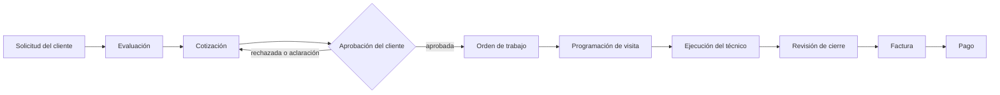
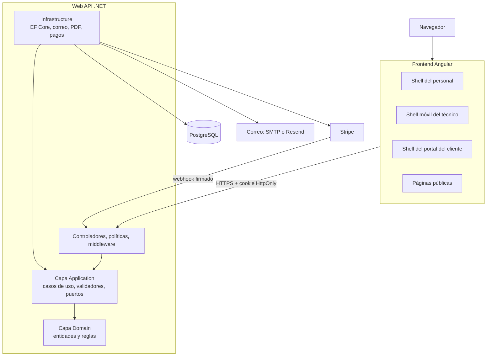
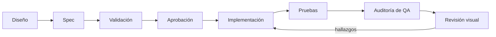

[English](README.md) | **Español**

<div align="center">

# FieldOps

**Una plataforma multi-tenant de gestión de servicios en campo construida con Angular, .NET y PostgreSQL.**

Clientes, solicitudes, cotizaciones, trabajos, visitas, técnicos, facturas y pagos en un solo sistema,<br>
con experiencias separadas para el personal de oficina, los técnicos de campo y los clientes.

[](.github/workflows/frontend-ci.yml)
[](.github/workflows/backend-ci.yml)
[](.github/workflows/integration-ci.yml)


Diseñado y construido en Colombia 🇨🇴

</div>

> **Proyecto de portafolio.** FieldOps no está desplegado públicamente y todavía no hay demo en vivo. Ver [Estado del proyecto](#28-estado-del-proyecto).

## Tabla de contenido

1. [Visión general del producto](#1-visión-general-del-producto)
2. [Motivación](#2-motivación)
3. [Capacidades principales](#3-capacidades-principales)
4. [Flujo de extremo a extremo](#4-flujo-de-extremo-a-extremo)
5. [Roles](#5-roles)
6. [Módulos](#6-módulos)
7. [Arquitectura](#7-arquitectura)
8. [Arquitectura del frontend](#8-arquitectura-del-frontend)
9. [Arquitectura del backend](#9-arquitectura-del-backend)
10. [Base de datos y multi-tenancy](#10-base-de-datos-y-multi-tenancy)
11. [Seguridad](#11-seguridad)
12. [Internacionalización](#12-internacionalización)
13. [Temas y sistema de diseño](#13-temas-y-sistema-de-diseño)
14. [Accesibilidad](#14-accesibilidad)
15. [Características de ingeniería destacadas](#15-características-de-ingeniería-destacadas)
16. [Metodología de desarrollo](#16-metodología-de-desarrollo)
17. [Ingeniería asistida por IA](#17-ingeniería-asistida-por-ia)
18. [Stack tecnológico](#18-stack-tecnológico)
19. [Estructura del repositorio](#19-estructura-del-repositorio)
20. [Primeros pasos](#20-primeros-pasos)
21. [Configuración del entorno](#21-configuración-del-entorno)
22. [Comandos comunes](#22-comandos-comunes)
23. [Pruebas y calidad](#23-pruebas-y-calidad)
24. [CI/CD](#24-cicd)
25. [Diseño y capturas](#25-diseño-y-capturas)
26. [Decisiones técnicas y retos](#26-decisiones-técnicas-y-retos)
27. [Documentación](#27-documentación)
28. [Estado del proyecto](#28-estado-del-proyecto)
29. [Autor](#29-autor)
30. [Licencia](#30-licencia)

---

## 1. Visión general del producto

FieldOps es una plataforma para empresas de servicios que operan con su propio personal: climatización, plomería, electricidad, limpieza,
mantenimiento y oficios similares. Cada empresa (una *organización*) programa y asigna a sus propios técnicos. **No es un
marketplace**: los clientes nunca eligen entre proveedores.

Las empresas en esta situación suelen llevar las solicitudes por correo, las cotizaciones en hojas de cálculo, la agenda en un tablero y
los pagos en otra herramienta. FieldOps mantiene en su lugar un único registro conectado:

- **Clientes** con contactos, propiedades y un historial completo.
- **Solicitudes** que llegan desde el personal, desde un formulario público por organización o desde el portal del cliente.
- **Evaluaciones y cotizaciones** con versiones, líneas opcionales y aprobación del cliente mediante un enlace seguro.
- **Órdenes de trabajo y visitas** programadas en un calendario de despacho y asignadas a técnicos.
- **Ejecución en campo** en una interfaz para técnicos pensada primero para móvil: listas de verificación, materiales, evidencias y registro de tiempo.
- **Revisión de facturación, facturas y pagos**, incluidos pagos con tarjeta y transferencias bancarias reportadas.

Tres experiencias comparten un mismo backend: la **app del personal** (roles de oficina), la **app del técnico** (shell móvil)
y el **portal del cliente**.

## 2. Motivación

FieldOps nació como un proyecto de portafolio con un objetivo concreto: construir una aplicación empresarial completa en lugar de una
demostración visual. Los flujos operativos reales obligan a tomar decisiones de ingeniería reales, y este proyecto fue una forma de practicarlas y
mostrarlas de principio a fin:

- Una arquitectura de frontend y backend que se mantiene sostenible a medida que se acumulan módulos.
- Seguridad, multi-tenancy, autorización y auditoría tratadas como requisitos centrales, no como un añadido posterior.
- Diseño de producto y de interacción, incluidos el comportamiento responsive y la accesibilidad.
- Internacionalización (inglés y español) y un sistema de temas centralizado.
- Automatización y controles de calidad: lint, formato, pruebas, CI y verificaciones de consistencia propias.

El historial del repositorio empieza el 2026-09-21. El trabajo se hizo en un ciclo intensivo de aproximadamente tres semanas, lo
cual solo fue posible porque cada funcionalidad pasó por planificación, una spec escrita, revisión y validación antes de integrarse
(ver [Metodología de desarrollo](#16-metodología-de-desarrollo)). No pretende ser una afirmación de velocidad.

## 3. Capacidades principales

**Gestión de clientes**
- Clientes, contactos y propiedades.
- Solicitudes, cotizaciones, trabajos, facturas y línea de tiempo de actividad relacionados con el cliente.
- Etiquetas y notas; invitaciones al portal para los contactos del cliente.

**Ciclo de vida del servicio**
- Solicitudes de servicio con un pipeline de ingreso y un formulario público de solicitudes por organización.
- Evaluaciones, cotizaciones y versiones de cotización.
- Órdenes de trabajo, incluidos trabajos recurrentes.
- Visitas y despacho.
- Listas de verificación, materiales y evidencias.
- Revisión de cierre y de facturación.

**Operaciones del equipo**
- Miembros del equipo y perfiles de técnico.
- Habilidades, disponibilidad semanal y tiempo libre.
- Calendario de despacho con carga de trabajo y utilización.
- Agenda del técnico, resumen de tiempo e historial de trabajos.
- Mensajes internos.

**Operaciones financieras**
- Facturas y pagos.
- Reporte de transferencias bancarias.
- Revisión de trabajos completados.
- Antigüedad de facturas.
- Reportes de rentabilidad y financieros, con historial de exportaciones.

**Administración**
- Configuración de la organización y de sucursales, horarios de atención.
- Usuarios, invitaciones y roles.
- Registro de auditoría y centro de notificaciones.
- Configuración de la cuenta, preferencias de idioma y apariencia.
- Catálogo de productos y servicios, plantillas de listas de verificación.

**Experiencia del cliente**
- Portal del cliente con panel, citas y propiedades.
- Creación de solicitudes y solicitudes de reprogramación.
- Respuestas a cotizaciones (aprobar, rechazar, pedir una aclaración).
- Flujo de factura y pago.
- Mensajes del portal.

## 4. Flujo de extremo a extremo



| Paso | Quién participa |
| --- | --- |
| Solicitud | El cliente (portal o formulario público) o el personal en nombre del cliente. |
| Evaluación y cotización | El despachador (o el owner) programa la evaluación y arma la cotización; el gerente de operaciones puede seguir el avance. |
| Aprobación | El cliente responde mediante un enlace con token o desde el portal. |
| Orden de trabajo y programación | El despachador crea la orden de trabajo, programa las visitas y asigna técnicos. |
| Ejecución | Los técnicos se desplazan, trabajan, pausan, completan listas de verificación y registran materiales y evidencias desde el shell móvil. |
| Revisión de cierre | Contabilidad (o el owner) revisa los trabajos completados antes de facturar; los demás roles de oficina pueden ver la cola. |
| Factura y pago | Contabilidad emite la factura; el cliente paga con tarjeta o reporta una transferencia bancaria; el personal registra los pagos. |

## 5. Roles

| Rol | Propósito |
| --- | --- |
| Owner | Control total de la organización, incluidos ajustes, usuarios y reportes a nivel de negocio. |
| Operations Manager | Supervisa la operación diaria: panel, trabajos, despacho, equipo y catálogo. Acceso de lectura a clientes, solicitudes y facturación. |
| Dispatcher | Gestiona clientes, solicitudes y cotizaciones, crea órdenes de trabajo, programa visitas y asigna técnicos. |
| Technician | Ejecuta las visitas asignadas desde el shell móvil. |
| Accounting | Revisa trabajos completados, genera facturas y registra pagos. También lee clientes, solicitudes, reportes y el registro de auditoría. |
| Viewer | Acceso de solo lectura a la mayoría de las áreas de oficina (no al registro de auditoría ni al resumen del negocio). |
| Usuario del portal del cliente | Un contacto del cliente que ve únicamente sus propios registros a través del portal. |

Los códigos de rol (`owner`, `operations_manager`, `dispatcher`, `technician`, `accounting`, `viewer`) se siembran desde el
[esquema de base de datos](docs/database/fieldops-schema.sql). Los usuarios del portal se autentican mediante una sesión separada.

> **La autorización la aplica el backend.** Los guards del frontend y los elementos de menú ocultos solo mejoran la experiencia;
> cada petición se autoriza de nuevo en el servidor.

## 6. Módulos

| Grupo | Módulo | Responsabilidad | Usuarios principales |
| --- | --- | --- | --- |
| **Resumen** | Panel de operaciones | Vista diaria de solicitudes, visitas, técnicos y alertas. | Operaciones, Despacho |
| | Resumen del negocio | KPIs, ingresos, pipeline, flujo de caja, desempeño por sucursal, rentabilidad por servicio. | Owner |
| **Ventas** | Clientes | Fichas de cliente, contactos, propiedades, actividad y registros relacionados. | Roles de oficina |
| | Solicitudes | Pipeline de ingreso, evaluaciones, mensajes de la solicitud. | Despacho (gestión), roles de oficina (lectura) |
| | Cotizaciones | Constructor de cotizaciones, versiones, líneas opcionales, envío y manejo de respuestas públicas. | Despacho, Owner |
| **Operaciones** | Trabajos | Órdenes de trabajo, recurrencia, listas de verificación, materiales planificados, detalle del trabajo. | Operaciones, Despacho |
| | Agenda | Calendario de despacho, asignación, cancelación/reprogramación, carga de trabajo. | Despacho |
| | App del técnico | Hoy, agenda, detalle de visita, progreso, cierre y resumen de tiempo. | Técnicos |
| **Equipo** | Equipo | Miembros, perfiles de técnico, habilidades, disponibilidad, tiempo libre, historial de trabajos. | Operaciones, Owner |
| | Mensajes | Conversaciones internas y mensajes del portal. | Personal, Clientes |
| **Finanzas** | Revisión de facturación | Cola de trabajos completados, revisión de evidencias y generación de facturas. | Contabilidad |
| | Facturas | Borradores, envío, pagos, antigüedad, reportes de transferencia bancaria. | Contabilidad |
| | Reportes | Catálogo de reportes con filtros, gráficos, tablas, exportaciones e historial de exportaciones. | Owner, Operations Manager, Dispatcher, Contabilidad |
| **Administración** | Organización y sucursales | Perfil de la empresa, sucursales, horarios de atención, logo. | Owner |
| | Usuarios y permisos | Invitaciones, roles, asignación de sucursales, matriz de permisos. | Owner |
| | Catálogo | Categorías, productos y servicios, plantillas de listas de verificación. | Operaciones |
| | Registro de auditoría | Registro consultable de acciones sensibles. | Owner, Operations Manager, Contabilidad |
| | Notificaciones, búsqueda, ayuda | Centro de notificaciones, búsqueda global, centro de ayuda. | Todos |
| **Portal del cliente** | Portal | Panel, solicitudes, citas, cotizaciones, facturas, propiedades, mensajes. | Clientes |
| **Público** | Formulario de solicitud, enlaces de cotización y de factura | Puntos de entrada anónimos protegidos por slug o token con hash. | Clientes |

## 7. Arquitectura



Notas sobre lo que aparece en el diagrama:

- Las dependencias apuntan hacia adentro: `Api → Application + Infrastructure`, `Infrastructure → Application + Domain`,
  `Application → Domain`.
- El correo sale por SMTP (Mailpit en local) o Resend. Los correos de invitación y de recuperación de contraseña se encolan y los envía un
  servicio hospedado en segundo plano después de que se confirma la transacción de la base de datos.
- Los archivos subidos (adjuntos de solicitudes, evidencias, fotos, logos) se almacenan en PostgreSQL; no hay almacenamiento de objetos
  externo.
- Los pagos con tarjeta usan Stripe y son opcionales: sin claves de Stripe la función se reporta como no disponible.
- Los PDF (cotizaciones, facturas, recibos, informes de cierre, reportes) se generan en el servidor con PDFsharp-MigraDoc.

## 8. Arquitectura del frontend

Aplicación Angular 22 standalone con TypeScript estricto y plantillas estrictas.

- **Organización por features.** `features/<name>/` contiene rutas, páginas, componentes, modelos, servicios y archivos de i18n.
  El código pasa a `shared/` solo cuando una segunda feature lo necesita.
- **Rutas lazy.** Las rutas de las features se cargan de forma lazy; los archivos de traducción se cargan por scope de feature.
- **Tres shells.** `app-shell` (personal), `technician-shell` (móvil) y `portal-shell` (clientes), cada uno con su propia navegación.
- **Servicios de API tipados.** Los servicios son dueños de `HttpClient` y construyen las URL a partir de un único `API_CONFIG`.
- **Interceptores.** `authInterceptor` (credenciales por cookie solo en las URL de la API, sin tokens), `portalUnauthorizedInterceptor`
  y `errorInterceptor`, que convierte las respuestas de problema en errores tipados. El texto de error del backend nunca se muestra a los usuarios.
- **Guards.** `authGuard`, `guestGuard`, `portalGuard`, más guards por feature. Son solo una capa de UX.
- **Estado.** Signals para el estado local síncrono; RxJS para el trabajo asíncrono; `inject()` para la inyección de dependencias.
- **UI.** PrimeNG 22 (preset Aura), SCSS, tokens `--fo-*` centralizados y un enfoque responsive mobile-first.
- **Estados.** Los estados de carga, vacío, error y permisos se implementan donde la spec aprobada lo pide.
- **Formularios.** La validación del cliente refleja las reglas del servidor; los errores por campo de la API se asignan a mensajes localizados.
- **Pruebas y lint.** Vitest mediante el builder de pruebas unitarias de Angular, `angular-eslint`, Prettier y dos verificaciones propias (i18n, tema).

```text
frontend/src/
├── app/
│   ├── core/        configuración, guards, interceptores, i18n, tema, servicios de sesión y compartidos
│   ├── shared/      UI independiente de features (diálogos, drawers, selectores) y utilidades
│   ├── layout/      app-shell, technician-shell, portal-shell, sidebar
│   └── features/    customers, requests, quotes, jobs, schedule, team, invoices, reports,
│                    portal, technician-jobs, audit-log, account, ...
├── styles/          _tokens, _base, _fonts, _breakpoints
└── environments/
```

## 9. Arquitectura del backend

Una solución .NET 10 (`backend/FieldOps.slnx`) organizada como Clean Architecture con un dominio al estilo DDD.

| Proyecto | Responsabilidad |
| --- | --- |
| `FieldOps.Domain` | Entidades selladas con setters privados, fábricas `Create(...)` que hacen cumplir las invariantes, enums. Sin dependencia de EF Core ni de ASP.NET. |
| `FieldOps.Application` | Handlers de casos de uso por feature, validadores FluentValidation, puertos (interfaces) y view models. |
| `FieldOps.Infrastructure` | Stores de EF Core que implementan los puertos, migraciones, envío de correo, gateway de Stripe, generadores de PDF, hashing, throttles en memoria. |
| `FieldOps.Api` | Controladores delgados, políticas de autorización, autenticación, límite de tasa, middleware y configuración. |
| `tests/` | Pruebas unitarias y de integración (Testcontainers + `WebApplicationFactory`). |

Patrones que realmente se usan:

- **Clean Architecture e inversión de dependencias.** La capa Application define los puertos; Infrastructure los implementa.
- **Handlers de casos de uso por feature.** Los handlers son clases simples que invocan los controladores. No hay librería de mediador,
  así que esto no es una implementación formal de CQRS.
- **Stores de persistencia.** Clases store específicas por feature sobre EF Core en lugar de un repositorio genérico.
- **Validación.** FluentValidation más validación de opciones (`IValidateOptions<T>` con `ValidateOnStart()`), de modo que la API
  se niega a arrancar con una configuración inválida.
- **Políticas de autorización.** Un handler `MembershipRoleRequirement` respalda clases de políticas por feature.
- **Transacciones.** Las operaciones de varios registros corren en una sola transacción; las filas en disputa se bloquean con `SELECT ... FOR UPDATE`.
- **Eventos de auditoría.** Las acciones sensibles escriben filas de auditoría mediante un escritor compartido; la presentación aplica redacción.

```text
backend/
├── FieldOps.slnx
├── src/
│   ├── FieldOps.Domain/          Customers, Quotes, WorkOrders, Invoices, Technicians, ...
│   ├── FieldOps.Application/     Features/*, Validation, Auditing, Authentication
│   ├── FieldOps.Infrastructure/  Persistence (stores, Configurations, Migrations), Email, Payments, Pdf, Authentication
│   └── FieldOps.Api/             Controllers, Authorization, Middleware, Extensions
└── tests/
    ├── FieldOps.UnitTests/
    └── FieldOps.IntegrationTests/
```

## 10. Base de datos y multi-tenancy

- **PostgreSQL 17** con **EF Core 10** y el proveedor Npgsql. Nombres en snake case, enums de PostgreSQL, `DateTimeOffset` en UTC.
- **Esquema.** Unas 70 tablas, documentadas en [`docs/database/fieldops-schema.sql`](docs/database/fieldops-schema.sql), que
  es la fuente autoritativa. Las configuraciones de EF se revisan contra él. El README no lo duplica.
- **Migraciones.** 39 migraciones de EF Core en `Persistence/Migrations`. Generarlas y aplicarlas son pasos
  deliberadamente separados (ver [Primeros pasos](#20-primeros-pasos)).
- **Aislamiento por organización.** Las tablas de tenant llevan un `organization_id`, y la organización se resuelve en el servidor a partir de
  la sesión. Las tablas hijas usan claves foráneas compuestas para que una fila hija no pueda referenciar un padre de otra organización.
- **Alcance por sucursal.** Las membresías pueden limitarse a sucursales específicas. Un resolvedor de alcance de sucursal filtra las lecturas y verifica las escrituras.
- **Datos históricos.** Las asignaciones de visitas conservan `assigned_at` y `unassigned_at`, de modo que las reasignaciones siguen siendo visibles. Los cambios de estado de solicitudes y
  visitas se guardan en tablas de historial. Las versiones de cotización se congelan al enviarse. Las facturas conservan una instantánea del cliente.
- **Auditoría.** Una tabla `audit_logs` registra quién hizo qué, con metadatos redactados.
- **Índices.** Ejemplos: los índices únicos parciales garantizan una asignación activa por visita y técnico y un técnico principal
  activo por visita.
- **Concurrencia.** Las mutaciones llevan un token `updatedAt`; un valor desactualizado devuelve `409` en lugar de sobrescribir datos más recientes.
  El registro de pagos también acepta una clave de idempotencia.
- **Por qué se revalida en el backend.** Nunca se confía en un identificador de tenant o en un id que venga del cliente. Cada id se comprueba contra
  la organización de la sesión y el alcance de sucursal, y los ids de otros tenants responden el mismo `404` que los inexistentes.

## 11. Seguridad

Los controles siguientes están implementados y documentados en [`docs/authentication.es.md`](docs/authentication.es.md) y
[`docs/backend/api-configuration.es.md`](docs/backend/api-configuration.es.md). Son controles de ingeniería, no una afirmación
de certificación o cumplimiento formal.

| Área | Qué está implementado |
| --- | --- |
| Autenticación | Email y contraseña; cookie de sesión HttpOnly cifrada (`fieldops_session`); sin JWT ni tokens de refresco. |
| Contraseñas | Hashing PBKDF2; longitud mínima de 12 caracteres. |
| Sesiones | El usuario, la membresía y la organización se revisan de nuevo en cada petición. Un cambio de contraseña invalida las sesiones anteriores. |
| Portal | Cookie separada (`fieldops_portal_session`); cada esquema ignora la cookie del otro. |
| Autorización | Políticas de rol por feature, comprobadas en el servidor. |
| Aislamiento por tenant y sucursal | Organización resuelta en el servidor; alcance de sucursal en lecturas y escrituras; `404` idéntico para recursos ajenos. |
| Límite de tasa | Inicio de sesión, invitaciones, restablecimiento de contraseña, solicitudes públicas, enlaces de cotización/factura y endpoints de escritura del portal. Varios throttles son en memoria y por proceso. |
| Errores seguros | Respuestas ProblemDetails con mensajes neutros; los tokens inutilizables devuelven una única respuesta idéntica. |
| Tokens | Los tokens de invitación, restablecimiento de contraseña y enlaces públicos son aleatorios; solo se almacena su SHA-256. Los tokens viajan en el fragmento de la URL o en el cuerpo de la petición. |
| Registro de auditoría | Las acciones sensibles se registran; la presentación oculta los metadatos sensibles. |
| Subidas | Tipo detectado por el contenido, tamaños limitados, cabeceras de respuesta seguras al servir archivos. |
| Pagos | Webhook de Stripe verificado por firma; número de cuenta bancaria cifrado con AES-256-GCM; el registro de pagos es idempotente. |
| Reautorización | Las mutaciones vuelven a comprobar permisos y estado en el servidor, sin importar lo que ofreciera la UI. |

## 12. Internacionalización

- **Idiomas:** inglés (base y fallback) y español (Colombia), mediante [Transloco](https://jsverse.gitbook.io/transloco).
- **Preferencia:** se guarda por usuario (`PUT /account/language`, también para usuarios del portal) y se aplica antes de la primera pantalla.
- **Cobertura:** shells, formularios, estados, mensajes de validación, títulos de ruta, enums, roles y acciones de auditoría.
- **Scopes:** un diccionario raíz más un diccionario de carga lazy por feature.
- **Formato:** fechas, horas, números y moneda siguen el locale activo; los plurales usan `Intl.PluralRules`.
- **Sin texto escrito directamente:** un script propio `i18n:check` analiza el código y corre en CI.
- **Extensibilidad:** los idiomas soportados se definen en un único archivo de configuración, así que agregar portugués significa agregar una entrada, un código en el backend y archivos de traducción. Está planificado, no implementado.

Detalles: [`docs/frontend/i18n-architecture.es.md`](docs/frontend/i18n-architecture.es.md).

## 13. Temas y sistema de diseño

- **Modos:** claro, oscuro y *sistema* (por defecto). La elección se persiste y se aplica antes del primer pintado.
- **Tokens:** las custom properties `--fo-*` se declaran en un solo archivo; los componentes las consumen con `var()`.
- **PrimeNG:** preset Aura con una paleta teal; modo oscuro mediante la clase `.app-dark`.
- **Colores semánticos:** tokens de estado, marca y superficie, sin valores crudos de paleta en los componentes.
- **Sidebar:** conserva su identidad navy tanto en modo claro como oscuro.
- **Responsive:** mobile-first, con breakpoints pensados para teléfonos, tablets, portátiles de 13 pulgadas y escritorio; el shell del técnico usa su propio layout móvil.
- **Salvaguarda:** un script propio `theme:check` detecta colores fijos y corre en CI.

Detalles: [`docs/frontend/styling-architecture.es.md`](docs/frontend/styling-architecture.es.md).

## 14. Accesibilidad

WCAG AA es un requisito de ingeniería del sistema de diseño, pero **no se ha hecho una auditoría formal de accesibilidad**, así que
no se declara ningún nivel de conformidad.

Prácticas implementadas:

- Estructura semántica y landmarks en los shells.
- Controles operables con teclado y un fallback visible de `:focus-visible` en los estilos globales.
- Etiquetas ARIA en controles que solo tienen icono; los iconos decorativos son `aria-hidden`.
- Campos de formulario con etiqueta y mensajes de error asociados.
- Objetivos táctiles de mínimo 44 px.
- `prefers-reduced-motion` se respeta en los estilos globales y en componentes seleccionados.
- Regiones `aria-live` / de estado para mensajes dinámicos.
- Verificaciones automáticas con `axe-core` en pruebas de componentes seleccionados (inicio de sesión y app shell).

## 15. Características de ingeniería destacadas

| Característica | Por qué es interesante |
| --- | --- |
| Arquitectura multi-tenant | El aislamiento lo garantizan el contexto del lado del servidor, las claves foráneas compuestas y respuestas uniformes de no encontrado. |
| Autorización de grano fino | Las políticas por feature y una matriz de permisos mantienen al backend como fuente de verdad. |
| Acceso a datos por sucursal | Los usuarios pueden restringirse a sucursales; las lecturas y las escrituras lo respetan. |
| Asignaciones históricas de visitas | La reasignación conserva el historial en lugar de sobrescribirlo, respaldada por índices únicos parciales. |
| Registro de auditoría | Eventos consultables con redacción para que el registro sea útil sin filtrar datos sensibles. |
| Centro de notificaciones y búsqueda global | Funciones transversales que respetan los permisos de cada usuario. |
| Internacionalización | Cambio de idioma en tiempo de ejecución con diccionarios lazy y verificación en CI. |
| Sistema de temas | Modos claro, oscuro y sistema migrados a tokens centrales, con una verificación estilo lint. |
| Experiencia móvil del técnico | Un shell separado para el trabajo del día, el progreso de la visita, el registro de tiempo y el cierre. |
| Concurrencia optimista | Los tokens `updatedAt` convierten las actualizaciones perdidas en conflictos `409` explícitos. |
| Pagos idempotentes | El registro de pagos acepta una clave de idempotencia; las repeticiones no duplican el movimiento de dinero. |
| Exportaciones a PDF y CSV | Cotizaciones, facturas, recibos, informes de cierre y reportes se generan en el servidor; las tablas de reportes se exportan a CSV. |
| Validación del lado del servidor | Cada regla se revalida en el servidor y se reporta con errores por campo. |

## 16. Metodología de desarrollo

FieldOps sigue un flujo guiado por specs. Cada funcionalidad de negocio tiene una spec escrita en [`specs/`](specs/) con reglas
de negocio, contratos de API y criterios de aceptación. El repositorio contiene actualmente 51 specs.



1. **Descubrimiento y diseño primero.** Los flujos y pantallas se definen antes del código.
2. **Spec.** Las reglas de negocio, los estados, los permisos y los criterios de aceptación se dejan por escrito.
3. **Revisión y aprobación.** La spec se valida y se aprueba antes de empezar la implementación.
4. **Implementación.** El trabajo de backend y frontend sigue el contrato aprobado. Los cambios de persistencia se revisan contra el esquema.
5. **Pruebas.** Una política de pruebas basada en riesgo favorece las pruebas que demuestran comportamiento distinto (autorización, tenancy, rollback, concurrencia) sobre la cobertura por archivo.
6. **QA.** Una auditoría independiente contrasta el cambio con la spec y ejecuta la suite de validación.
7. **Revisión visual y responsive.** La hace el autor de forma manual en varios tamaños de pantalla.
8. **Iteración.** Los hallazgos vuelven a la implementación.

Los estados del ciclo de vida de una spec son `APPROVED` y `AUDITED`. Las reglas del flujo viven en [`CLAUDE.md`](CLAUDE.md).

## 17. Ingeniería asistida por IA

Se usó una herramienta de IA (Claude Code) durante todo el proyecto, y esta sección explica cómo.

- **Dónde ayudó:** exploración, redacción de specs y documentación, generación inicial de código y revisión.
- **Quién decidió:** el alcance del producto, la arquitectura, la aceptación y cada integración fueron dirigidos por el desarrollador.
- **Responsabilidades separadas:** [`.claude/agents/`](.claude/agents) define agentes especializados (arquitectos y desarrolladores de backend y frontend, diseñador de UI, revisor de base de datos, auditor de QA) y [`.claude/skills/`](.claude/skills) define los flujos de spec, implementación y auditoría.
- **Specs como contrato:** la implementación se guía por specs aprobadas, no por prompts libres.
- **Salvaguardas:** las reglas del proyecto prohíben aplicar o eliminar bases de datos, leer secretos, hacer push a ramas protegidas sin que se pida,
  y saltarse los hooks. Un hook de seguridad bloquea los comandos que modifican la base de datos.
- **Verificación:** el formato, el lint, las pruebas y los builds corren localmente mediante hooks de Git y en CI; el QA visual lo realiza manualmente el autor.
- **Límites:** algunas specs se aceptaron con seguimientos documentados cuando se omitió una auditoría; esos puntos se registran en lugar de ocultarse.

## 18. Stack tecnológico

Las versiones provienen de `package.json`, los archivos `.csproj`, los workflows y `docker-compose.yml`.

| Categoría | Tecnología | Versión |
| --- | --- | --- |
| **Frontend** | Angular | 22.1 |
| | TypeScript | 6.0 |
| | PrimeNG (Aura mediante `@primeuix/themes`) | 22.1 |
| | SCSS | mediante el build de Angular |
| | RxJS | 7.8 |
| | Transloco | 8.4 |
| | Stripe.js | 10 |
| **Backend** | .NET / ASP.NET Core / C# | .NET 10 |
| | Entity Framework Core + Npgsql | 10 |
| | FluentValidation | 12.1 |
| | PDFsharp-MigraDoc | 6.2 |
| | Stripe.net | 53 |
| | Swashbuckle (Swagger UI, solo desarrollo) | 10.2 |
| **Base de datos** | PostgreSQL | 17 (`postgres:17-alpine`) |
| **Herramientas** | Node.js (CI) | 24 |
| | npm | 9.7.1 (`packageManager`) |
| | ESLint / angular-eslint / typescript-eslint | 10 / 22.5 / 8.69 |
| | Prettier | 3.8 |
| | Vitest + jsdom | 4 / 28 |
| | axe-core | 4.13 |
| | xUnit + Testcontainers (PostgreSQL) | 2.9 / 4.15 |
| | Docker Compose (PostgreSQL, Mailpit) | |
| | GitHub Actions | 3 workflows |
| | Hooks de Git (`.githooks/`) | pre-commit, pre-push |

## 19. Estructura del repositorio

```text
/
├── frontend/   Aplicación Angular, scripts propios de verificación de i18n y tema
├── backend/    Solución .NET: Domain, Application, Infrastructure, Api y pruebas
├── docs/       Referencias de backend, frontend, base de datos y ayuda
├── specs/      Especificaciones aprobadas de las funcionalidades (una carpeta por funcionalidad)
├── .claude/    Agentes, skills, ajustes y hook de seguridad del flujo asistido por IA
├── .githooks/  Verificaciones de pre-commit y pre-push
└── .github/    Workflows de CI
```

## 20. Primeros pasos

### Requisitos previos

- Git
- Node.js 24 y npm
- SDK de .NET 10
- Docker Desktop o Docker Engine (PostgreSQL y Mailpit corren con Docker Compose)

### Configuración

```bash
# 1. Clonar
git clone https://github.com/juandavid3196/fieldops.git
cd fieldops

# 2. Ajustes locales de la base de datos (solo valores de ejemplo en .env.example)
cp .env.example .env        # luego edita .env con tus propios valores locales

# 3. Iniciar PostgreSQL y el capturador local de correo
docker compose up -d

# 4. Backend: herramientas y paquetes
cd backend
dotnet tool restore
dotnet restore FieldOps.slnx

# 5. Define la cadena de conexión con user-secrets (los valores deben coincidir con tu .env)
dotnet user-secrets set "ConnectionStrings:FieldOpsDatabase" "<tu cadena de conexión>" --project src/FieldOps.Api

# 6. Frontend
cd ../frontend
npm ci
```

### Migraciones de base de datos

Las migraciones las aplica el desarrollador, de forma deliberada y fuera de cualquier flujo de agentes. Con tu propia base de datos local:

```bash
cd backend
dotnet ef database update \
  --project src/FieldOps.Infrastructure/FieldOps.Infrastructure.csproj \
  --startup-project src/FieldOps.Api/FieldOps.Api.csproj
```

Es el mismo comando que ejecuta CI contra su base de datos desechable. Nunca lo ejecutes contra datos que te importen sin una copia de seguridad.

### Ejecutar

```bash
# Terminal 1: API (usa el perfil http; la redirección a https rompe CORS en local)
cd backend
dotnet run --project src/FieldOps.Api --launch-profile http     # http://localhost:5034

# Terminal 2: Angular
cd frontend
npm start                                                       # http://localhost:4200
```

Swagger UI está disponible en desarrollo en `http://localhost:5034/swagger`. Los correos enviados en local aparecen en Mailpit en
`http://127.0.0.1:8025`.

No se proporcionan datos de ejemplo ni credenciales de demostración. Crea una organización mediante el flujo de registro.

## 21. Configuración del entorno

Aquí solo se listan nombres. Los valores nunca se versionan.

| Dónde | Nombre | Propósito |
| --- | --- | --- |
| `.env` en la raíz (ver [`.env.example`](.env.example)) | `POSTGRES_DB`, `POSTGRES_USER`, `POSTGRES_PASSWORD`, `POSTGRES_PORT` | Contenedor local de PostgreSQL. |
| API (user-secrets o entorno) | `ConnectionStrings__FieldOpsDatabase` | Conexión a PostgreSQL. Obligatoria. |
| API | `Cors__AllowedOrigins__0` | Origen(es) permitidos del frontend. Development permite `http://localhost:4200`. |
| API | `Email__Provider`, `Email__SenderAddress`, `Email__SenderName` | Envío de correo. Development usa SMTP hacia Mailpit; producción requiere `Resend`. |
| API | `Email__Smtp__*`, `Email__Resend__ApiKey` | Ajustes específicos de cada proveedor. |
| API (opcional) | `Stripe__SecretKey`, `Stripe__PublishableKey`, `Stripe__WebhookSecret` | Pagos con tarjeta; deshabilitados si faltan. |
| API (opcional) | `BankDetails__EncryptionKey` | Habilita los datos de transferencia bancaria; deshabilitado si falta. |
| Frontend | `src/environments/environment*.ts` | `apiBaseUrl`: `http://localhost:5034` en desarrollo, `/api` en producción (reverse proxy del mismo origen que quita `/api`). Archivos públicos, sin secretos. |

Referencia: [`docs/backend/api-configuration.es.md`](docs/backend/api-configuration.es.md) y
[`docs/frontend/frontend-configuration.es.md`](docs/frontend/frontend-configuration.es.md).

## 22. Comandos comunes

**Frontend** (desde `frontend/`)

| Tarea | Comando |
| --- | --- |
| Instalar | `npm ci` |
| Iniciar | `npm start` |
| Build | `npm run build -- --configuration production` |
| Pruebas | `npm run test -- --watch=false` |
| Lint | `npm run lint` |
| Verificar / aplicar formato | `npm run format:check` / `npm run format` |
| Verificación de i18n | `npm run i18n:check` (autoprueba: `npm run i18n:check:test`) |
| Verificación de tema | `npm run theme:check` (autoprueba: `npm run theme:check:test`) |

**Backend** (desde `backend/`)

| Tarea | Comando |
| --- | --- |
| Restaurar | `dotnet tool restore` y luego `dotnet restore FieldOps.slnx` |
| Build | `dotnet build FieldOps.slnx --configuration Release --no-restore` |
| Pruebas unitarias | `dotnet test tests/FieldOps.UnitTests/FieldOps.UnitTests.csproj --configuration Release --no-build` |
| Pruebas de integración (requieren Docker) | `dotnet test tests/FieldOps.IntegrationTests/FieldOps.IntegrationTests.csproj --configuration Release --no-build` |
| Verificar formato | `dotnet format FieldOps.slnx --verify-no-changes --no-restore` |
| Ejecutar la API | `dotnet run --project src/FieldOps.Api --launch-profile http` |
| Agregar una migración | `dotnet ef migrations add <Name> --project src/FieldOps.Infrastructure/FieldOps.Infrastructure.csproj --startup-project src/FieldOps.Api/FieldOps.Api.csproj --output-dir Persistence/Migrations` |

Revisa una migración generada antes de aplicarla, y nunca edites una que ya se aplicó.

## 23. Pruebas y calidad

- **Frontend:** pruebas Vitest de componentes, servicios, guards e interceptores, más verificaciones con `axe-core` en pantallas seleccionadas.
- **Pruebas unitarias del backend:** reglas no triviales de dominio, validación y cálculo.
- **Pruebas de integración del backend:** el pipeline real de la API contra PostgreSQL mediante Testcontainers (requiere Docker). Cubren los
  límites de autorización, aislamiento de tenants, rollback y concurrencia.
- **Verificaciones estáticas:** ESLint, Prettier, `dotnet format` y configuraciones estrictas de TypeScript/nullable.
- **Verificaciones propias:** `i18n:check` (texto faltante o escrito directamente) y `theme:check` (colores fijos).
- **Validación de build:** build de producción de Angular y build Release de .NET.
- **Hooks de Git:** pre-commit verifica formato y lint; pre-push ejecuta las pruebas y el build del frontend más el build y las pruebas unitarias del backend.
- **QA visual y responsive:** lo hace el autor de forma manual; ninguna automatización de navegador forma parte de CI.

El repositorio no tiene reportes de cobertura, así que no se declara ninguna cifra de cobertura. La política de pruebas favorece las pruebas que demuestran
comportamiento y riesgo distintos en lugar de una prueba por archivo.

No hay un proyecto de pruebas de dependencias de arquitectura; las referencias entre capas las hacen cumplir las referencias entre proyectos.

## 24. CI/CD

Tres workflows en [`.github/workflows/`](.github/workflows) se ejecutan en pushes y pull requests hacia `main`/`master`, y pueden iniciarse manualmente:

| Workflow | Pasos |
| --- | --- |
| [`frontend-ci.yml`](.github/workflows/frontend-ci.yml) | Node 24, `npm ci`, verificación de formato, lint, verificación de i18n, verificación de tema, pruebas, build de producción. |
| [`backend-ci.yml`](.github/workflows/backend-ci.yml) | .NET 10, restauración de herramientas y paquetes, verificación de formato, build Release, pruebas unitarias. |
| [`integration-ci.yml`](.github/workflows/integration-ci.yml) | Contenedor de servicio PostgreSQL 17, build, migraciones de EF aplicadas a la base de datos efímera de CI, pruebas de integración. |

Todos usan permisos de solo lectura y cancelan las ejecuciones reemplazadas. **No hay workflow de despliegue**: el proyecto no está desplegado.

## 25. Diseño y capturas

> **Capturas pendientes.** Todavía no hay capturas curadas versionadas en el repositorio, y este README no usa imágenes
> simuladas. Capturas planificadas: panel de operaciones, calendario de despacho, detalle de cliente, cotizaciones, trabajos, vista móvil
> del técnico, reportes y modo oscuro. Se agregarán en `docs/` cuando termine la pasada final de QA visual.

Mientras tanto, las mejores referencias son las specs de pantallas en [`specs/`](specs/) (por ejemplo
[`dispatch-calendar`](specs/dispatch-calendar/spec.md) y [`app-dark-mode`](specs/app-dark-mode/spec.md)).

## 26. Decisiones técnicas y retos

- **Aislamiento de tenants.** El contexto de la organización viene de la sesión, nunca de un campo de la petición. Los hijos de tenant usan
  claves foráneas compuestas, de modo que la integridad se protege en la base de datos y no solo en el código.
- **Autorización por sucursal.** Los permisos por rol no bastaban; un resolvedor de alcance de sucursal filtra los datos y protege las escrituras. Los ids ajenos responden el mismo `404` que los inexistentes.
- **Transiciones de estado de las visitas.** Las visitas pasan por un conjunto controlado de estados con una tabla de historial, de modo que cada transición se valida y es trazable.
- **Asignaciones históricas.** Las asignaciones se cierran con `unassigned_at` en lugar de borrarse; los índices únicos parciales mantienen una asignación activa por técnico y un principal por visita.
- **Trabajos recurrentes.** Las órdenes de trabajo pueden ser recurrentes (de semanal a trimestral, de 2 a 24 ocurrencias), restringidas por reglas `CHECK` en el esquema.
- **Registro de tiempo.** Las entradas de tiempo tienen tipo (`work`, `pause`, `travel`) y se valida su orden.
- **Interfaz del técnico.** La experiencia de campo es su propio shell y no un layout de escritorio comprimido.
- **i18n consistente.** Traducir una aplicación grande es sobre todo un problema de consistencia, así que el proyecto agregó una verificación en CI y un sistema de scopes en lugar de depender de la revisión.
- **Migración al modo oscuro.** Las pantallas existentes se pasaron a tokens centralizados, con un verificador que evita regresar a colores crudos.
- **Escrituras desactualizadas.** Los tokens `updatedAt` y las respuestas `409` evitan sobrescrituras silenciosas; los pagos agregan claves de idempotencia y bloqueo de filas.
- **Auditoría útil sin datos sensibles.** Los metadatos de auditoría se redactan al presentarlos, de modo que los operadores pueden investigar sin exponer secretos.
- **Specs incrementales.** Los módulos grandes se dividieron en specs pequeñas con reglas de negocio y criterios de aceptación explícitos, lo que hizo cada porción revisable.

## 27. Documentación

| Tema | Enlace |
| --- | --- |
| Autenticación | [`English`](docs/authentication.md) · [`Español`](docs/authentication.es.md) |
| Configuración y endpoints de la API | [`English`](docs/backend/api-configuration.md) · [`Español`](docs/backend/api-configuration.es.md) |
| Configuración del frontend | [`English`](docs/frontend/frontend-configuration.md) · [`Español`](docs/frontend/frontend-configuration.es.md) |
| Internacionalización | [`English`](docs/frontend/i18n-architecture.md) · [`Español`](docs/frontend/i18n-architecture.es.md) |
| Estilos y tokens | [`English`](docs/frontend/styling-architecture.md) · [`Español`](docs/frontend/styling-architecture.es.md) |
| Esquema de base de datos | [`fieldops-schema.sql`](docs/database/fieldops-schema.sql); informe de auditoría: [`English`](docs/database/schema-audit-report.md) · [`Español`](docs/database/schema-audit-report.es.md) |
| Contenido del centro de ayuda | [`English`](docs/help/help-center.md) · [`Español`](docs/help/help-center.es.md) |
| Especificaciones (sin traducir) | [`specs/`](specs/) |
| Reglas del proyecto | [`CLAUDE.md`](CLAUDE.md), [`backend/CLAUDE.md`](backend/CLAUDE.md), [`frontend/CLAUDE.md`](frontend/CLAUDE.md) |

## 28. Estado del proyecto

**Completado**
- Flujos centrales del producto desde la solicitud hasta el pago, en las experiencias del personal, el técnico y el portal.
- Localización en español e inglés, temas claro/oscuro/sistema, layouts responsive.
- CI para el frontend, el backend y las pruebas de integración.

**Pulido final**
- Pasadas de QA responsive y visual.
- Documentación y capturas curadas.
- Algunos seguimientos documentados de auditorías que se aceptaron con omisión.

**Ideas futuras**
- Despliegue público y demo.
- Localización en portugués (la estructura de i18n está preparada para ello).

## 29. Autor

**Juan David Rios**, Full-Stack Software Engineer.
Stack principal: Angular, .NET, PostgreSQL.

- Portafolio: [jdrr-portfolio.vercel.app](https://jdrr-portfolio.vercel.app/)
- LinkedIn: [juan-david-rios-rodriguez](https://www.linkedin.com/in/juan-david-rios-rodriguez-93415b214/)
- GitHub: [juandavid3196](https://github.com/juandavid3196)

Diseñado y construido en Colombia 🇨🇴

## 30. Licencia

No se incluye un archivo de licencia. FieldOps es un proyecto de portafolio, y todos los derechos están reservados por el autor salvo que se agregue una licencia más adelante.
