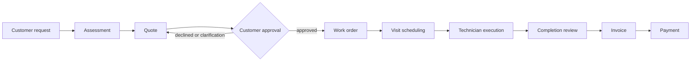
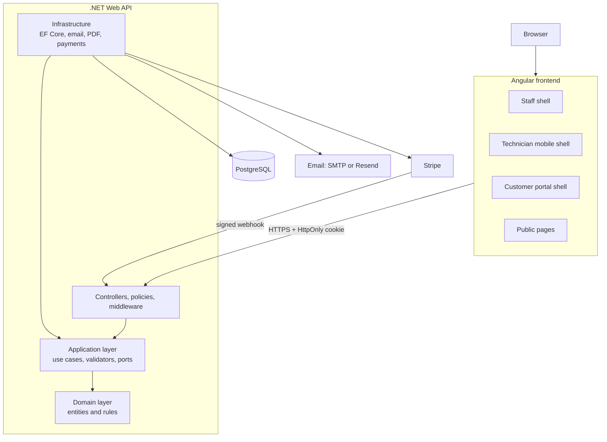
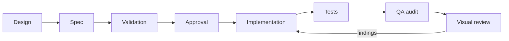

**English** | [Español](README.es.md)

<div align="center">

# FieldOps

**A multi-tenant field service management platform built with Angular, .NET and PostgreSQL.**

Customers, requests, quotes, jobs, visits, technicians, invoices and payments in one system,<br>
with separate experiences for office staff, field technicians and customers.

[](.github/workflows/frontend-ci.yml)
[](.github/workflows/backend-ci.yml)
[](.github/workflows/integration-ci.yml)


Designed and built in Colombia 🇨🇴

</div>

> **Portfolio project.** FieldOps is not deployed publicly and there is no live demo yet. See [Project status](#28-project-status).

## Table of contents

1. [Product overview](#1-product-overview)
2. [Motivation](#2-motivation)
3. [Key capabilities](#3-key-capabilities)
4. [End-to-end workflow](#4-end-to-end-workflow)
5. [Roles](#5-roles)
6. [Modules](#6-modules)
7. [Architecture](#7-architecture)
8. [Frontend architecture](#8-frontend-architecture)
9. [Backend architecture](#9-backend-architecture)
10. [Database and multi-tenancy](#10-database-and-multi-tenancy)
11. [Security](#11-security)
12. [Internationalization](#12-internationalization)
13. [Theming and design system](#13-theming-and-design-system)
14. [Accessibility](#14-accessibility)
15. [Notable engineering features](#15-notable-engineering-features)
16. [Development methodology](#16-development-methodology)
17. [AI-assisted engineering](#17-ai-assisted-engineering)
18. [Technology stack](#18-technology-stack)
19. [Repository structure](#19-repository-structure)
20. [Getting started](#20-getting-started)
21. [Environment configuration](#21-environment-configuration)
22. [Common commands](#22-common-commands)
23. [Testing and quality](#23-testing-and-quality)
24. [CI/CD](#24-cicd)
25. [Design and screenshots](#25-design-and-screenshots)
26. [Technical decisions and challenges](#26-technical-decisions-and-challenges)
27. [Documentation](#27-documentation)
28. [Project status](#28-project-status)
29. [Author](#29-author)
30. [License](#30-license)

---

## 1. Product overview

FieldOps is a platform for service businesses that run their own workforce: HVAC, plumbing, electrical, cleaning,
maintenance and similar trades. Each company (an *organization*) schedules and assigns its own technicians. It is
**not a marketplace**: customers never choose between providers.

Companies in this position usually track requests in email, quotes in spreadsheets, schedules on a whiteboard and
payments in a separate tool. FieldOps keeps one connected record instead:

- **Customers** with contacts, properties and a full history.
- **Requests** that arrive from staff, from a public form per organization, or from the customer portal.
- **Assessments and quotes** with versions, optional lines and customer approval through a secure link.
- **Work orders and visits** scheduled on a dispatch calendar and assigned to technicians.
- **Field execution** on a mobile-first technician interface: checklists, materials, evidence and time tracking.
- **Billing review, invoices and payments**, including card payments and reported bank transfers.

Three experiences share one backend: the **staff app** (office roles), the **technician app** (mobile-first shell)
and the **customer portal**.

## 2. Motivation

FieldOps began as a portfolio project with a specific goal: build a complete business application rather than a
visual demo. Real operational flows force real engineering decisions, and this project was a way to practice and
show them end to end:

- Frontend and backend architecture that stays maintainable as modules accumulate.
- Security, multi-tenancy, authorization and auditing treated as core requirements, not afterthoughts.
- Product and interaction design, including responsive behavior and accessibility.
- Internationalization (English and Spanish) and a centralized theme system.
- Automation and quality gates: linting, formatting, tests, CI and custom consistency checks.

The repository history starts on 2026-09-21. The work was done in an intensive cycle of roughly three weeks, which
was only possible because each feature went through planning, a written spec, review and validation before it was
merged (see [Development methodology](#16-development-methodology)). It is not meant as a speed claim.

## 3. Key capabilities

**Customer management**
- Customers, contacts and properties.
- Customer-related requests, quotes, jobs, invoices and activity timeline.
- Tags and notes; portal invitations for customer contacts.

**Service lifecycle**
- Service requests with an intake pipeline and a public request form per organization.
- Assessments, quotes and quote versions.
- Work orders, including recurring jobs.
- Visits and dispatch.
- Checklists, materials and evidence.
- Completion and billing review.

**Team operations**
- Team members and technician profiles.
- Skills, weekly availability and time off.
- Dispatch calendar with workload and utilization.
- Technician schedule, time summary and job history.
- Internal messages.

**Financial operations**
- Invoices and payments.
- Bank transfer reporting.
- Completed jobs review.
- Invoice aging.
- Profitability and financial reports, with export history.

**Administration**
- Organization and branch settings, business hours.
- Users, invitations and roles.
- Audit trail and notification center.
- Account settings, language and appearance preferences.
- Product and service catalog, checklist templates.

**Customer experience**
- Customer portal with dashboard, appointments and properties.
- Request creation and reschedule requests.
- Quote responses (approve, decline, ask for clarification).
- Invoice and payment flow.
- Portal messages.

## 4. End-to-end workflow



| Step | Who participates |
| --- | --- |
| Request | Customer (portal or public form) or staff on the customer's behalf. |
| Assessment and quote | The Dispatcher (or Owner) schedules the assessment and builds the quote; the Operations Manager can follow progress. |
| Approval | The customer responds through a tokenized link or from the portal. |
| Work order and scheduling | Dispatcher creates the work order, schedules visits and assigns technicians. |
| Execution | Technicians travel, work, pause, complete checklists and record materials and evidence from the mobile shell. |
| Completion review | Accounting (or Owner) reviews completed jobs before billing; other office roles can view the queue. |
| Invoice and payment | Accounting issues the invoice; the customer pays by card or reports a bank transfer; staff record payments. |

## 5. Roles

| Role | Purpose |
| --- | --- |
| Owner | Full control of the organization, including settings, users and business-level reporting. |
| Operations Manager | Oversees day-to-day operations: dashboard, jobs, dispatch, team and catalog. Read access to customers, requests and billing. |
| Dispatcher | Manages customers, requests and quotes, creates work orders, schedules visits and assigns technicians. |
| Technician | Executes assigned visits from the mobile shell. |
| Accounting | Reviews completed jobs, generates invoices and records payments. Also reads customers, requests, reports and the audit log. |
| Viewer | Read-only access to most office areas (not the audit log or the business overview). |
| Customer portal user | A customer contact who sees only their own records through the portal. |

Role codes (`owner`, `operations_manager`, `dispatcher`, `technician`, `accounting`, `viewer`) are seeded from the
[database schema](docs/database/fieldops-schema.sql). Portal users authenticate through a separate session.

> **Authorization is enforced by the backend.** Frontend guards and hidden menu items only improve the experience;
> every request is authorized again on the server.

## 6. Modules

| Group | Module | Responsibility | Main users |
| --- | --- | --- | --- |
| **Overview** | Operations dashboard | Day-level view of requests, visits, technicians and alerts. | Operations, Dispatch |
| | Business overview | KPIs, revenue, pipeline, cash flow, branch performance, service profitability. | Owner |
| **Sales** | Customers | Customer records, contacts, properties, activity and related records. | Office roles |
| | Requests | Intake pipeline, assessments, request messages. | Dispatch (manage), office roles (read) |
| | Quotes | Quote builder, versions, optional lines, sending and public response handling. | Dispatch, Owner |
| **Operations** | Jobs | Work orders, recurrence, checklists, planned materials, job detail. | Operations, Dispatch |
| | Schedule | Dispatch calendar, assignment, cancel/reschedule, workload. | Dispatch |
| | Technician app | Today, schedule, visit detail, progress, completion and time summary. | Technicians |
| **Team** | Team | Members, technician profiles, skills, availability, time off, job history. | Operations, Owner |
| | Messages | Internal conversations and portal messages. | Staff, Customers |
| **Finance** | Billing review | Queue of completed jobs, evidence review and invoice generation. | Accounting |
| | Invoices | Drafts, delivery, payments, aging, bank transfer reports. | Accounting |
| | Reports | Report catalog with filters, charts, tables, exports and export history. | Owner, Operations Manager, Dispatcher, Accounting |
| **Administration** | Organization and branches | Company profile, branches, business hours, logo. | Owner |
| | Users and permissions | Invitations, roles, branch assignment, permission matrix. | Owner |
| | Catalog | Categories, products and services, checklist templates. | Operations |
| | Audit trail | Searchable record of sensitive actions. | Owner, Operations Manager, Accounting |
| | Notifications, search, help | Notification center, global search, help center. | Everyone |
| **Customer portal** | Portal | Dashboard, requests, appointments, quotes, invoices, properties, messages. | Customers |
| **Public** | Request form, quote and invoice links | Anonymous entry points secured by slug or hashed token. | Customers |

## 7. Architecture



Notes on what is in the diagram:

- Dependencies point inward: `Api → Application + Infrastructure`, `Infrastructure → Application + Domain`,
  `Application → Domain`.
- Email goes through SMTP (Mailpit locally) or Resend. Invitation and password recovery emails are queued and sent by a
  hosted background service after the database transaction commits.
- Uploaded files (request attachments, evidence, photos, logos) are stored in PostgreSQL; there is no external object
  storage.
- Card payments use Stripe and are optional: without Stripe keys the feature is reported as unavailable.
- PDFs (quotes, invoices, receipts, completion reports, reports) are rendered server-side with PDFsharp-MigraDoc.

## 8. Frontend architecture

Angular 22 standalone application with strict TypeScript and strict templates.

- **Feature-oriented layout.** `features/<name>/` holds routes, pages, components, models, services and i18n files.
  Code moves to `shared/` only after a second feature needs it.
- **Lazy routes.** Feature routes are loaded lazily; translation files load per feature scope.
- **Three shells.** `app-shell` (staff), `technician-shell` (mobile) and `portal-shell` (customers), each with its own navigation.
- **Typed API services.** Services own `HttpClient` and build URLs from a single `API_CONFIG`.
- **Interceptors.** `authInterceptor` (cookie credentials on API URLs only, no tokens), `portalUnauthorizedInterceptor`
  and `errorInterceptor` that maps problem responses to typed errors. Backend error text is never shown to users.
- **Guards.** `authGuard`, `guestGuard`, `portalGuard`, plus feature guards. They are a UX layer only.
- **State.** Signals for local synchronous state; RxJS for asynchronous work; `inject()` for dependency injection.
- **UI.** PrimeNG 22 (Aura preset), SCSS, centralized `--fo-*` tokens and a mobile-first responsive approach.
- **States.** Loading, empty, error and permission states are implemented where the approved spec calls for them.
- **Forms.** Client validation mirrors server rules; field errors from the API are mapped to localized messages.
- **Tests and lint.** Vitest through the Angular unit-test builder, `angular-eslint`, Prettier and two custom checks (i18n, theme).

```text
frontend/src/
├── app/
│   ├── core/        config, guards, interceptors, i18n, theme, session and shared services
│   ├── shared/      feature-agnostic UI (dialogs, drawers, selectors) and utilities
│   ├── layout/      app-shell, technician-shell, portal-shell, sidebar
│   └── features/    customers, requests, quotes, jobs, schedule, team, invoices, reports,
│                    portal, technician-jobs, audit-log, account, ...
├── styles/          _tokens, _base, _fonts, _breakpoints
└── environments/
```

## 9. Backend architecture

A .NET 10 solution (`backend/FieldOps.slnx`) organized as Clean Architecture with a DDD-style domain.

| Project | Responsibility |
| --- | --- |
| `FieldOps.Domain` | Sealed entities with private setters, `Create(...)` factories that enforce invariants, enums. No EF Core or ASP.NET dependency. |
| `FieldOps.Application` | Use-case handlers per feature, FluentValidation validators, ports (interfaces) and view models. |
| `FieldOps.Infrastructure` | EF Core stores implementing the ports, migrations, email senders, Stripe gateway, PDF renderers, hashing, in-memory throttles. |
| `FieldOps.Api` | Thin controllers, authorization policies, authentication, rate limiting, middleware and configuration. |
| `tests/` | Unit tests and integration tests (Testcontainers + `WebApplicationFactory`). |

Patterns that are actually used:

- **Clean Architecture and dependency inversion.** The Application layer defines ports; Infrastructure implements them.
- **Use-case handlers per feature.** Handlers are plain classes called from controllers. There is no mediator library,
  so this is not a formal CQRS implementation.
- **Persistence stores.** Feature-specific store classes over EF Core rather than a generic repository.
- **Validation.** FluentValidation plus options validation (`IValidateOptions<T>` with `ValidateOnStart()`), so the API
  refuses to start on invalid configuration.
- **Authorization policies.** A `MembershipRoleRequirement` handler backs per-feature policy classes.
- **Transactions.** Multi-record operations run in one transaction; contested rows are locked with `SELECT ... FOR UPDATE`.
- **Audit events.** Sensitive actions write audit rows through a shared writer; presentation applies redaction.

```text
backend/
├── FieldOps.slnx
├── src/
│   ├── FieldOps.Domain/          Customers, Quotes, WorkOrders, Invoices, Technicians, ...
│   ├── FieldOps.Application/     Features/*, Validation, Auditing, Authentication
│   ├── FieldOps.Infrastructure/  Persistence (stores, Configurations, Migrations), Email, Payments, Pdf, Authentication
│   └── FieldOps.Api/             Controllers, Authorization, Middleware, Extensions
└── tests/
    ├── FieldOps.UnitTests/
    └── FieldOps.IntegrationTests/
```

## 10. Database and multi-tenancy

- **PostgreSQL 17** with **EF Core 10** and the Npgsql provider. Snake-case naming, PostgreSQL enums, `DateTimeOffset` in UTC.
- **Schema.** About 70 tables, documented in [`docs/database/fieldops-schema.sql`](docs/database/fieldops-schema.sql), which
  is the authoritative source. EF configurations are reviewed against it. The README does not duplicate it.
- **Migrations.** 39 EF Core migrations kept under `Persistence/Migrations`. Generating and applying them are
  deliberately separate steps (see [Getting started](#20-getting-started)).
- **Organization isolation.** Tenant tables carry an `organization_id`, and the organization is resolved server-side from
  the session. Child tables use composite foreign keys so a child row cannot reference a parent from another organization.
- **Branch scope.** Memberships can be limited to specific branches. A branch scope resolver filters reads and checks writes.
- **Historical data.** Visit assignments keep `assigned_at` and `unassigned_at`, so reassignments stay visible. Request and
  visit status changes are stored in history tables. Quote versions are frozen when sent. Invoices keep a customer snapshot.
- **Audit.** An `audit_logs` table records who did what, with redacted metadata.
- **Indexes.** Examples: partial unique indexes ensure one active assignment per visit and technician and one active primary
  technician per visit.
- **Concurrency.** Mutations carry an `updatedAt` token; a stale value returns `409` instead of overwriting newer data.
  Payment recording also accepts an idempotency key.
- **Why re-validate in the backend.** A tenant identifier or id from the client is never trusted. Every id is checked against
  the session organization and branch scope, and cross-tenant ids answer the same `404` as missing ones.

## 11. Security

Controls below are implemented and documented in [`docs/authentication.md`](docs/authentication.md) and
[`docs/backend/api-configuration.md`](docs/backend/api-configuration.md). They are engineering controls, not a claim
of formal certification or compliance.

| Area | What is implemented |
| --- | --- |
| Authentication | Email and password; encrypted HttpOnly session cookie (`fieldops_session`); no JWT or refresh tokens. |
| Passwords | PBKDF2 hashing; minimum length of 12 characters. |
| Sessions | User, membership and organization are rechecked on every request. A password change invalidates older sessions. |
| Portal | Separate cookie (`fieldops_portal_session`); each scheme ignores the other's cookie. |
| Authorization | Role policies per feature, checked server-side. |
| Tenant and branch isolation | Organization resolved on the server; branch scope on reads and writes; identical `404` for foreign resources. |
| Rate limiting | Sign-in, invitation, password reset, public request, quote/invoice link and portal write endpoints. Several throttles are in-memory and per process. |
| Safe errors | ProblemDetails responses with neutral messages; unusable tokens return one identical response. |
| Tokens | Invitation, password reset and public link tokens are random; only their SHA-256 is stored. Tokens travel in the URL fragment or request body. |
| Audit logging | Sensitive actions are recorded; presentation redacts sensitive metadata. |
| Uploads | Type detected from content, size limits enforced, safe response headers when serving files. |
| Payments | Stripe webhook verified by signature; bank account number encrypted with AES-256-GCM; payment recording is idempotent. |
| Reauthorization | Mutations re-check permission and state on the server, regardless of what the UI offered. |

## 12. Internationalization

- **Languages:** English (base and fallback) and Spanish (Colombia), via [Transloco](https://jsverse.gitbook.io/transloco).
- **Preference:** stored per user (`PUT /account/language`, also for portal users), applied before the first screen.
- **Coverage:** shells, forms, states, validation messages, route titles, enums, roles and audit actions.
- **Scopes:** a root dictionary plus one lazy-loaded dictionary per feature.
- **Formatting:** dates, times, numbers and currency follow the active locale; plurals use `Intl.PluralRules`.
- **No hardcoded text:** a custom `i18n:check` script scans the code and runs in CI.
- **Extensibility:** supported languages are defined in one config file, so adding Portuguese means adding an entry, a backend code and translation files. It is planned, not implemented.

Details: [`docs/frontend/i18n-architecture.md`](docs/frontend/i18n-architecture.md).

## 13. Theming and design system

- **Modes:** light, dark and *system* (default). The choice is persisted and applied before first paint.
- **Tokens:** `--fo-*` custom properties are declared in one file; components consume them with `var()`.
- **PrimeNG:** Aura preset with a teal palette; dark mode through the `.app-dark` class.
- **Semantic colors:** status, brand and surface tokens, with no raw palette values in components.
- **Sidebar:** keeps its navy identity in both light and dark mode.
- **Responsive:** mobile-first with breakpoints designed for phones, tablets, 13-inch laptops and desktop; the technician shell uses its own mobile layout.
- **Guardrail:** a custom `theme:check` script flags hardcoded colors and runs in CI.

Details: [`docs/frontend/styling-architecture.md`](docs/frontend/styling-architecture.md).

## 14. Accessibility

WCAG AA is an engineering requirement for the design system, but **no formal accessibility audit has been done**, so
no conformance level is claimed.

Implemented practices:

- Semantic structure and landmarks in the shells.
- Keyboard-operable controls and a visible `:focus-visible` fallback in global styles.
- ARIA labels on icon-only controls; decorative icons are `aria-hidden`.
- Labeled form fields with associated error messages.
- 44 px minimum touch targets.
- `prefers-reduced-motion` is honored in global styles and selected components.
- `aria-live` / status regions for dynamic messages.
- Automated checks with `axe-core` in selected component tests (sign-in and app shell).

## 15. Notable engineering features

| Feature | Why it is interesting |
| --- | --- |
| Multi-tenant architecture | Isolation is enforced by server-side context, composite foreign keys and uniform not-found responses. |
| Fine-grained authorization | Per-feature policies and a permission matrix keep the backend as the source of truth. |
| Branch-scoped data access | Users can be restricted to branches; reads and writes both honor it. |
| Historical visit assignments | Reassignment keeps history instead of overwriting it, backed by partial unique indexes. |
| Audit trail | Searchable events with redaction so the log is useful without leaking sensitive data. |
| Notification center and global search | Cross-module features that respect each user's permissions. |
| Internationalization | Runtime language switching with lazy dictionaries and CI enforcement. |
| Theme system | Light, dark and system modes migrated onto central tokens, with a lint-style check. |
| Technician mobile experience | A separate shell for today's work, visit progress, time tracking and completion. |
| Optimistic concurrency | `updatedAt` tokens turn lost updates into explicit `409` conflicts. |
| Idempotent payments | Payment recording takes an idempotency key; repeats do not duplicate money movement. |
| PDF and CSV exports | Quotes, invoices, receipts, completion reports and reports render server-side; report tables export to CSV. |
| Server-side validation | Every rule is re-validated on the server and reported with field-level errors. |

## 16. Development methodology

FieldOps follows a spec-driven workflow. Each business feature has a written spec in [`specs/`](specs/) with business
rules, API contracts and acceptance criteria. The repository currently holds 51 specs.



1. **Discovery and design first.** Flows and screens are defined before code.
2. **Spec.** Business rules, states, permissions and acceptance criteria are written down.
3. **Review and approval.** The spec is validated and approved before implementation starts.
4. **Implementation.** Backend and frontend work follows the approved contract. Persistence changes are reviewed against the schema.
5. **Tests.** A risk-based testing policy favors tests that prove distinct behavior (authorization, tenancy, rollback, concurrency) over per-file coverage.
6. **QA.** An independent audit checks the change against the spec and runs the validation suite.
7. **Visual and responsive review.** Done manually by the author at several viewport sizes.
8. **Iteration.** Findings go back to implementation.

Spec lifecycle states are `APPROVED` and `AUDITED`. Rules for the workflow live in [`CLAUDE.md`](CLAUDE.md).

## 17. AI-assisted engineering

AI tooling (Claude Code) was used throughout, and this section states how.

- **Where it helped:** exploration, drafting specs and documentation, initial code generation, and review.
- **Who decided:** product scope, architecture, acceptance and every merge were directed by the developer.
- **Separated responsibilities:** [`.claude/agents/`](.claude/agents) defines specialized agents (backend and frontend architects and
  developers, UI designer, database reviewer, QA auditor) and [`.claude/skills/`](.claude/skills) defines the spec, implementation and audit workflows.
- **Specs as contract:** implementation is driven by approved specs, not by free-form prompts.
- **Guardrails:** project rules forbid applying or dropping databases, reading secrets, pushing to protected branches without
  request, and bypassing hooks. A safety hook blocks database-mutating commands.
- **Verification:** formatting, lint, tests and builds run locally via Git hooks and in CI; visual QA is performed manually by the author.
- **Limits:** a few specs were accepted with documented follow-ups when an audit was overridden, and those items are tracked rather than hidden.

## 18. Technology stack

Versions are taken from `package.json`, the `.csproj` files, workflows and `docker-compose.yml`.

| Category | Technology | Version |
| --- | --- | --- |
| **Frontend** | Angular | 22.1 |
| | TypeScript | 6.0 |
| | PrimeNG (Aura via `@primeuix/themes`) | 22.1 |
| | SCSS | via Angular build |
| | RxJS | 7.8 |
| | Transloco | 8.4 |
| | Stripe.js | 10 |
| **Backend** | .NET / ASP.NET Core / C# | .NET 10 |
| | Entity Framework Core + Npgsql | 10 |
| | FluentValidation | 12.1 |
| | PDFsharp-MigraDoc | 6.2 |
| | Stripe.net | 53 |
| | Swashbuckle (Swagger UI, development only) | 10.2 |
| **Database** | PostgreSQL | 17 (`postgres:17-alpine`) |
| **Tooling** | Node.js (CI) | 24 |
| | npm | 9.7.1 (`packageManager`) |
| | ESLint / angular-eslint / typescript-eslint | 10 / 22.5 / 8.69 |
| | Prettier | 3.8 |
| | Vitest + jsdom | 4 / 28 |
| | axe-core | 4.13 |
| | xUnit + Testcontainers (PostgreSQL) | 2.9 / 4.15 |
| | Docker Compose (PostgreSQL, Mailpit) | |
| | GitHub Actions | 3 workflows |
| | Git hooks (`.githooks/`) | pre-commit, pre-push |

## 19. Repository structure

```text
/
├── frontend/   Angular application, custom i18n and theme check scripts
├── backend/    .NET solution: Domain, Application, Infrastructure, Api and tests
├── docs/       Backend, frontend, database and help references
├── specs/      Approved feature specifications (one folder per feature)
├── .claude/    Agents, skills, settings and safety hook used in the AI-assisted workflow
├── .githooks/  Pre-commit and pre-push checks
└── .github/    CI workflows
```

## 20. Getting started

### Prerequisites

- Git
- Node.js 24 and npm
- .NET 10 SDK
- Docker Desktop or Docker Engine (PostgreSQL and Mailpit run through Docker Compose)

### Setup

```bash
# 1. Clone
git clone https://github.com/juandavid3196/fieldops.git
cd fieldops

# 2. Local database settings (placeholders only in .env.example)
cp .env.example .env        # then edit .env with your own local values

# 3. Start PostgreSQL and the local mail catcher
docker compose up -d

# 4. Backend: tools and packages
cd backend
dotnet tool restore
dotnet restore FieldOps.slnx

# 5. Provide the connection string through user-secrets (values must match your .env)
dotnet user-secrets set "ConnectionStrings:FieldOpsDatabase" "<your connection string>" --project src/FieldOps.Api

# 6. Frontend
cd ../frontend
npm ci
```

### Database migrations

Migrations are applied by the developer, deliberately and outside any agent workflow. With your own local database:

```bash
cd backend
dotnet ef database update \
  --project src/FieldOps.Infrastructure/FieldOps.Infrastructure.csproj \
  --startup-project src/FieldOps.Api/FieldOps.Api.csproj
```

This is the same command CI runs against its throwaway database. Never run it against data you care about without a backup.

### Run

```bash
# Terminal 1: API (use the http profile; https redirection breaks local CORS)
cd backend
dotnet run --project src/FieldOps.Api --launch-profile http     # http://localhost:5034

# Terminal 2: Angular
cd frontend
npm start                                                       # http://localhost:4200
```

Swagger UI is available in development at `http://localhost:5034/swagger`. Emails sent locally appear in Mailpit at
`http://127.0.0.1:8025`.

No seed data or demo credentials are provided. Create an organization through the registration flow.

## 21. Environment configuration

Only names are listed here. Values are never committed.

| Where | Name | Purpose |
| --- | --- | --- |
| Root `.env` (see [`.env.example`](.env.example)) | `POSTGRES_DB`, `POSTGRES_USER`, `POSTGRES_PASSWORD`, `POSTGRES_PORT` | Local PostgreSQL container. |
| API (user-secrets or environment) | `ConnectionStrings__FieldOpsDatabase` | PostgreSQL connection. Required. |
| API | `Cors__AllowedOrigins__0` | Allowed frontend origin(s). Development allows `http://localhost:4200`. |
| API | `Email__Provider`, `Email__SenderAddress`, `Email__SenderName` | Email delivery. Development uses SMTP to Mailpit; production requires `Resend`. |
| API | `Email__Smtp__*`, `Email__Resend__ApiKey` | Provider-specific settings. |
| API (optional) | `Stripe__SecretKey`, `Stripe__PublishableKey`, `Stripe__WebhookSecret` | Card payments; disabled when absent. |
| API (optional) | `BankDetails__EncryptionKey` | Enables bank transfer details; disabled when absent. |
| Frontend | `src/environments/environment*.ts` | `apiBaseUrl`: `http://localhost:5034` in development, `/api` in production (same-origin reverse proxy that strips `/api`). Public files, no secrets. |

Reference: [`docs/backend/api-configuration.md`](docs/backend/api-configuration.md) and
[`docs/frontend/frontend-configuration.md`](docs/frontend/frontend-configuration.md).

## 22. Common commands

**Frontend** (from `frontend/`)

| Task | Command |
| --- | --- |
| Install | `npm ci` |
| Start | `npm start` |
| Build | `npm run build -- --configuration production` |
| Test | `npm run test -- --watch=false` |
| Lint | `npm run lint` |
| Format check / write | `npm run format:check` / `npm run format` |
| i18n check | `npm run i18n:check` (self-test: `npm run i18n:check:test`) |
| Theme check | `npm run theme:check` (self-test: `npm run theme:check:test`) |

**Backend** (from `backend/`)

| Task | Command |
| --- | --- |
| Restore | `dotnet tool restore` then `dotnet restore FieldOps.slnx` |
| Build | `dotnet build FieldOps.slnx --configuration Release --no-restore` |
| Unit tests | `dotnet test tests/FieldOps.UnitTests/FieldOps.UnitTests.csproj --configuration Release --no-build` |
| Integration tests (needs Docker) | `dotnet test tests/FieldOps.IntegrationTests/FieldOps.IntegrationTests.csproj --configuration Release --no-build` |
| Format check | `dotnet format FieldOps.slnx --verify-no-changes --no-restore` |
| Run API | `dotnet run --project src/FieldOps.Api --launch-profile http` |
| Add a migration | `dotnet ef migrations add <Name> --project src/FieldOps.Infrastructure/FieldOps.Infrastructure.csproj --startup-project src/FieldOps.Api/FieldOps.Api.csproj --output-dir Persistence/Migrations` |

Review a generated migration before applying it, and never edit one that was already applied.

## 23. Testing and quality

- **Frontend:** Vitest component, service, guard and interceptor tests, plus `axe-core` checks on selected screens.
- **Backend unit tests:** non-trivial domain, validation and calculation rules.
- **Backend integration tests:** the real API pipeline against PostgreSQL through Testcontainers (needs Docker). They cover
  authorization, tenant isolation, rollback and concurrency boundaries.
- **Static checks:** ESLint, Prettier, `dotnet format`, and strict TypeScript/nullable settings.
- **Custom checks:** `i18n:check` (missing or hardcoded text) and `theme:check` (hardcoded colors).
- **Build validation:** production Angular build and Release .NET build.
- **Git hooks:** pre-commit checks formatting and lint; pre-push runs frontend tests and build plus backend build and unit tests.
- **Visual and responsive QA:** performed manually by the author; no browser automation is part of CI.

The repository has no coverage reports, so no coverage figure is claimed. The testing policy favors tests that prove
distinct behavior and risk rather than one test per file.

There is no architecture-dependency test project; layer references are enforced by the project references.

## 24. CI/CD

Three workflows in [`.github/workflows/`](.github/workflows) run on pushes and pull requests to `main`/`master`, and can be started manually:

| Workflow | Steps |
| --- | --- |
| [`frontend-ci.yml`](.github/workflows/frontend-ci.yml) | Node 24, `npm ci`, format check, lint, i18n check, theme check, tests, production build. |
| [`backend-ci.yml`](.github/workflows/backend-ci.yml) | .NET 10, tool and package restore, format verification, Release build, unit tests. |
| [`integration-ci.yml`](.github/workflows/integration-ci.yml) | PostgreSQL 17 service container, build, EF migrations applied to the ephemeral CI database, integration tests. |

All use read-only permissions and cancel superseded runs. **There is no deployment workflow**: the project is not deployed.

## 25. Design and screenshots

> **Screenshots pending.** No curated screenshots are committed to the repository yet, and this README does not use mock
> images. Planned captures: operations dashboard, dispatch calendar, customer detail, quotes, jobs, technician mobile view,
> reports and dark mode. They will be added under `docs/` once the final visual QA pass is complete.

Until then, the best references are the screen specs in [`specs/`](specs/) (for example
[`dispatch-calendar`](specs/dispatch-calendar/spec.md) and [`app-dark-mode`](specs/app-dark-mode/spec.md)).

## 26. Technical decisions and challenges

- **Tenant isolation.** Organization context comes from the session, never from a request field. Tenant children use
  composite foreign keys, so integrity is protected at the database level and not only in code.
- **Branch-scoped authorization.** Role permissions alone were not enough; a branch scope resolver filters data and guards writes. Foreign ids answer the same `404` as missing ones.
- **Visit state transitions.** Visits move through a controlled set of statuses with a history table, so each transition is validated and traceable.
- **Historical assignments.** Assignments are closed with `unassigned_at` instead of deleted; partial unique indexes keep one active assignment per technician and one primary per visit.
- **Recurring jobs.** Work orders can be recurring (weekly to quarterly, 2 to 24 occurrences), constrained by `CHECK` rules in the schema.
- **Time tracking.** Time entries are typed (`work`, `pause`, `travel`) and validated for ordering.
- **Technician interface.** The field experience is its own shell rather than a squeezed desktop layout.
- **Consistent i18n.** Translating a large application is mostly a consistency problem, so the project added a CI check and a scope system instead of relying on review.
- **Dark mode migration.** Existing screens were moved onto centralized tokens, with a checker to stop regressions to raw colors.
- **Stale writes.** `updatedAt` tokens and `409` responses prevent silent overwrites; payments add idempotency keys and row locks.
- **Useful audit without sensitive data.** Audit metadata is redacted at presentation time, so operators can investigate without exposing secrets.
- **Incremental specs.** Large modules were split into small specs with explicit business rules and acceptance criteria, which made each slice reviewable.

## 27. Documentation

| Topic | Link |
| --- | --- |
| Authentication | [`English`](docs/authentication.md) · [`Español`](docs/authentication.es.md) |
| API configuration and endpoints | [`English`](docs/backend/api-configuration.md) · [`Español`](docs/backend/api-configuration.es.md) |
| Frontend configuration | [`English`](docs/frontend/frontend-configuration.md) · [`Español`](docs/frontend/frontend-configuration.es.md) |
| Internationalization | [`English`](docs/frontend/i18n-architecture.md) · [`Español`](docs/frontend/i18n-architecture.es.md) |
| Styling and tokens | [`English`](docs/frontend/styling-architecture.md) · [`Español`](docs/frontend/styling-architecture.es.md) |
| Database schema | [`fieldops-schema.sql`](docs/database/fieldops-schema.sql); audit report: [`English`](docs/database/schema-audit-report.md) · [`Español`](docs/database/schema-audit-report.es.md) |
| Help center content | [`English`](docs/help/help-center.md) · [`Español`](docs/help/help-center.es.md) |
| Specifications (not translated) | [`specs/`](specs/) |
| Project rules | [`CLAUDE.md`](CLAUDE.md), [`backend/CLAUDE.md`](backend/CLAUDE.md), [`frontend/CLAUDE.md`](frontend/CLAUDE.md) |

## 28. Project status

**Completed**
- Core product flows from request to payment, across staff, technician and portal experiences.
- Spanish and English localization, light/dark/system themes, responsive layouts.
- CI for frontend, backend and integration tests.

**Final polish**
- Responsive and visual QA passes.
- Documentation and curated screenshots.
- A few documented follow-ups from audits that were accepted with overrides.

**Future ideas**
- Public deployment and demo.
- Portuguese localization (the i18n structure is prepared for it).

## 29. Author

**Juan David Rios**, Full-Stack Software Engineer.
Main stack: Angular, .NET, PostgreSQL.

- Portfolio: [jdrr-portfolio.vercel.app](https://jdrr-portfolio.vercel.app/)
- LinkedIn: [juan-david-rios-rodriguez](https://www.linkedin.com/in/juan-david-rios-rodriguez-93415b214/)
- GitHub: [juandavid3196](https://github.com/juandavid3196)

Designed and built in Colombia 🇨🇴

## 30. License

No license file is included. FieldOps is a portfolio project, and all rights are reserved by the author unless a license is added later.
